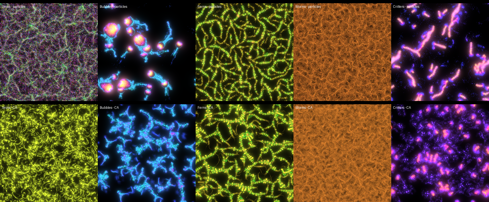
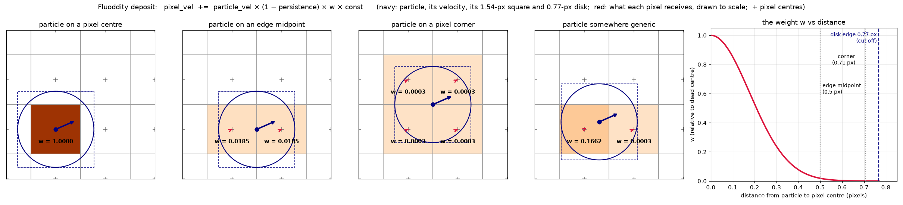
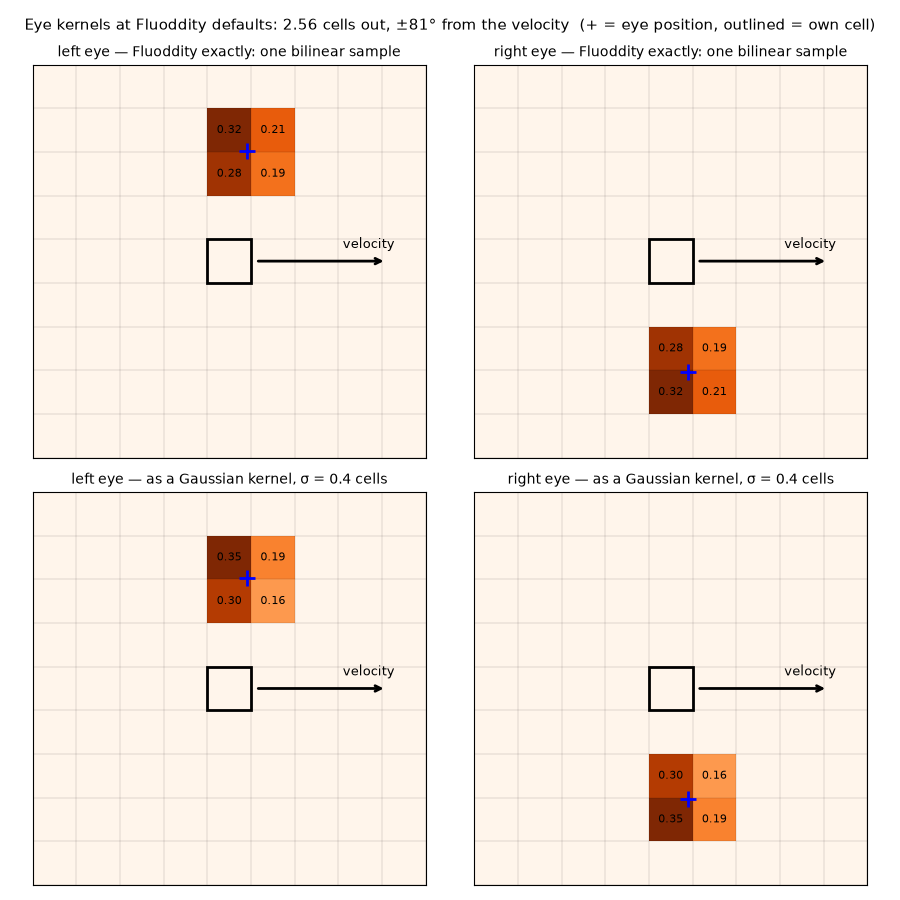
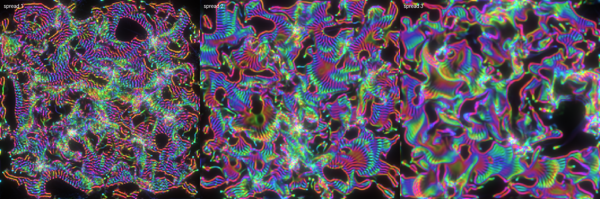
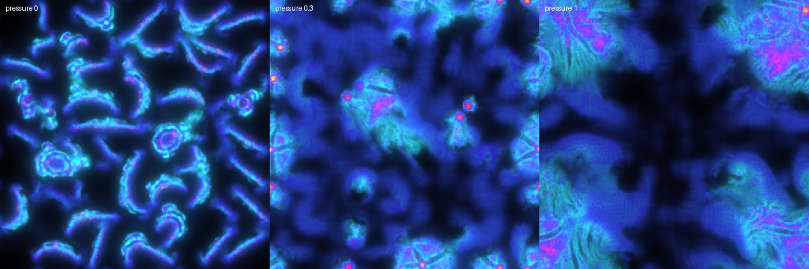

# Fluoddity CA

[Fluoddity](https://github.com/aphid91/Fluoddity), by aphid91, re-implemented in WebGL2 and then turned into a cellular automaton. There are no particles in the CA: every cell holds a mass and a velocity.

| page | what it is |
|---|---|
| [`fluoddity.html`](fluoddity.html) | Fluoddity rebuilt from its shaders, with all 131 of its presets |
| [`fluoddity-ca.html`](fluoddity-ca.html) | the same model as a CA, kept frozen as the first faithful version |
| [`fluoddity-ca-next.html`](fluoddity-ca-next.html) | the CA we keep changing: spread, pressure, colour by force |

Each page is a single file with no build step and no dependencies. Open it in a desktop browser with a GPU.



## Fluoddity

A physarum-style particle system. Particles never sense each other; they only read the trail the others leave. The trail records **velocity**, not density, so opposite flows cancel. Each particle's behaviour comes from a small Fourier "brain" with 80 parameters.

```
Grid:      float[H, W, 2]     # trail: net flow (x, y) per pixel, faded and blurred

Particle:
    pos: vec2                 # state
    vel: vec2                 # state; its direction is the heading
    brain: Brain              # shared by its cohort: 4 numbers in, 4 out

Globals: drag, strafe_power, sensor_angle, sensor_dist, sensor_gain, persistence, diffusion, ...

step():
    for p in particles:
        fwd = normalize(p.vel)
        L = local(sample(grid, p.pos + rot(+angle)·fwd·dist), fwd)   # (along, across)
        R = local(sample(grid, p.pos + rot(-angle)·fwd·dist), fwd)
        out = brain(L, R) + mirror(brain(mirror(R), mirror(L)))     # no left/right bias
        force, strafe = to_world(out[0:2]), to_world(out[2:4])
        p.vel = p.vel * drag + force
        p.pos = p.pos + p.vel + strafe * strafe_power               # strafe: a hop, never stored

    grid = blur(grid) * persistence
    for p in particles:
        grid[p.pos] += p.vel * (1 - persistence)                    # a sharp 1-4 pixel splat
```

- **brain(x):** `Σᵢ ampᵢ · [sin φ, cos φ, sin 2φ, cos 2φ]`, where `φ = freqᵢ·x + offsetᵢ`, over 10 terms.
- **mirror(v):** `(v.along, −v.across)`. The brain runs once in a mirrored world and the result is mirrored back, so turning left and turning right are equally likely.
- **Colour:** hue = 0.5 × the forward part of the force.
- **Cohorts:** groups of particles, each with its own mutated copy of the brain. Clicking a particle makes its cohort's brain the new parent.



## Fluoddity as a CA

The same model with the particles replaced by fields, built up one piece at a time.

1. **Grids.**
   - Trail `float[H, W, 2]`, as in Fluoddity.
   - Velocity `float[H, W, 2]`: the "particle" in each cell.
   - Mass `float[H, W, 1]`: how many particles' worth of stuff the cell holds.
2. **Brain.** Fluoddity's, unchanged, with the mirror trick. The whole grid runs one cohort's brain.
3. **Perception.** Two eye kernels at Fluoddity's defaults: 2.56 × `sensor_distance` cells out, at ±`sensor_angle`·π from the cell's velocity. Each is a single bilinear tap, which is close to a σ ≈ 0.4 Gaussian. Projected onto the velocity and its perpendicular, they give the brain's 4 inputs.
4. **Force.** Not scaled by mass, as in Fluoddity. An empty cell computes a force but carries nothing, so it acts like no particle.\*
5. **Velocity.** `vel = vel·drag + force`.
6. **Move.** Each cell sends its mass, its momentum (mass·vel) and its colour to `cell + vel + strafe·strafe_power`, split by overlap over the cells there. Each cell's new velocity is its momentum ÷ mass. This is advection by reintegration tracking, and it conserves mass exactly.
7. **Deposit.** `trail += mass · vel · (1 − persistence) · 7.07`. The 7.07 is Fluoddity's average splat weight per particle. Mass is counted in particles, so every Fluoddity constant carries over unchanged.

\* Something to experiment with later: scaling the force by mass.



The original Fluoddity has neither of these. Both are in `fluoddity-ca-next.html`:

- **Spread.** The box that carries the mass can be wider than one cell (1–5 cells). Wider means softer and more liquid; 1 gives the plain bilinear move.

  

- **Pressure.** Mass above a rest level pushes down its own gradient (a Sobel gradient over the 3×3 neighbourhood). At 0 it is exactly the original model; as it grows, the mass flows like a liquid.

  

### Measurements

- **How far mass moves.** Measured per step over 300 steps, in 12 presets so far. The median is 0.2–1.6 cells, and the 99th percentile is 0.3–6 cells in 9 of them. The fast ones are Growth (10 cells), Dandelions (18 cells, median 3.1) and Curls (6 cells). So a fixed neighbourhood of about 17×17 makes this a strict CA for most presets, but not all.
- **Speed.** Measured with a CPU renderer, so only the ratios mean anything. At 600k particles against 1024² cells, the CA is about 3× slower than the particles at spread 1 and about 6× slower at spread 2. It runs the brain in every cell, and its scatter draws 4 to 9 points per cell.

## Files

- `src/*.tmpl.html` + `src/presets.js` are the sources. `python3 src/build.py` writes the three pages.
- `src/extract_presets.py` rebuilds `presets.js` from a clone of Fluoddity.
- `tools/*.js` are headless Playwright drivers: screenshots, how far mass moves, timing, the spread and pressure sweeps. Open a page with `?manual` and drive it through `window.__fl`.
- `tools/*.py` draw the deposit and kernel diagrams.

Fluoddity is MIT licensed. Its presets and algorithm are aphid91's.
